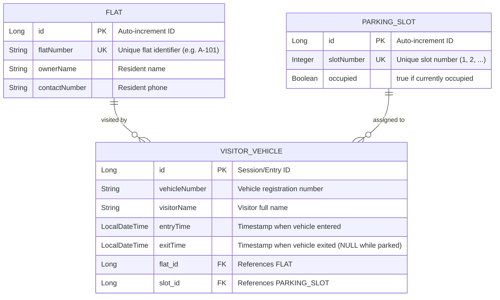

# ParkSpot — Smart Society Visitor Parking Management System
## Complete Project Implementation & Professional Landing Redesign Report (`done.md`)

---

## 1. Executive Summary & Transformation Scope

### Original Context & Challenge
The original user interface defaulted to Swagger UI or raw API endpoint inspection, making it appear like an API testing interface or unfinished prototype rather than a real-world software product.

### Transformation Delivered
ParkSpot has been transformed into a **commercial-grade, full-stack Smart Society Parking Management SaaS application**:
1. **Public Landing Website**: A SaaS landing page that presents ParkSpot to society residents, security guards, and management committees. Features a high-resolution hero parking visual (`assets/parkspot_hero_banner.jpg`), real-time telemetry badge, 6 core feature cards, a 5-step operational gate workflow, an interactive live bay inventory preview, and key society benefits.
2. **Executive Management Console**: An administration and security guard dashboard with live metrics, an interactive 20-bay visual parking grid with Indian registration plates (`[IND] ...`), quick allocation, visitor registration modals, one-click checkout flows, a flats directory, and daily audit reports.
3. **Seamless Dual-View Architecture**: The Landing Page is the default view. Users can click **"Open Dashboard"** or **"Explore Dashboard"** to switch into the security console, and click **"← Back to Landing Page"** at any time to return.
4. **Backend & Database Integrity**: Zero regressions to existing Spring Boot REST controllers, services, repositories, JPA entities, MySQL profiles (`application-mysql.properties`), or existing database records.

---

## 2. Technology Stack & Architecture

### Backend (Spring Boot 3.2.5 + Java 17)
- **Framework**: Spring Boot 3.2.5
- **ORM & Data**: Spring Data JPA with Hibernate 6
- **Database Profiles**:
  - `mysql`: Production profile configured with MySQL 8.0 connection pooling (`application-mysql.properties`)
  - `default`: In-memory H2 profile with web console (`application.properties`)
- **Validation**: Jakarta Bean Validation (`@Valid`, `@NotNull`, `@NotBlank`, `@Positive`)
- **Documentation**: Springdoc OpenAPI / Swagger UI (v2.5.0 preserved at `/swagger-ui.html` for API verification)
- **Routing**: `WebConfig.java` maps the root path (`/`) to the embedded production landing application (`/index.html`)

### Frontend (Modern Responsive Web App)
- **Design System**: Aviation-grade Dark Navy theme (`#070d18` / `#0b1325`), crisp typography (`Plus Jakarta Sans` and `JetBrains Mono`), glassmorphic cards, and vibrant emerald green & crimson status indicators.
- **Visual Assets**: Commercial architectural photography of modern smart parking facility with green LED sensor indicators (`assets/parkspot_hero_banner.jpg`).
- **Icons**: Handcrafted scalable Lucide SVG vectors (zero broken third-party font or emoji dependencies).
- **Tooling**: Built with Vite 5 (`npm run build` compiled in 641ms) and packaged inside Spring Boot's static resource container.

---

## 3. Database Entity Relationship Model



---

## 4. Landing Page Structure & Feature Highlights

### A. Navigation Bar
- Brand Wordmark: **ParkSpot.** with emerald green dot and "Smart Society Parking" subtitle.
- Section links with smooth scrolling: `Home`, `Live Overview`, `Features`, `How It Works`, `Parking Grid`, `Benefits`, `Contact`.
- Real-time Backend Connection Pill (`🟢 Live Society Feed`).
- Prominent **"Open Dashboard"** CTA button.

### B. Hero Section
- **Main Heading**: *"Smarter Parking. Safer Communities."*
- **Supporting Description**: *"Manage society parking slots, track visitor vehicles, and simplify entry and exit operations with one intelligent parking management platform."*
- Action buttons: **"Explore Dashboard"** and **"Discover Features"**.
- Hero Visual Card with high-resolution smart residential parking facility and floating live telemetry indicators.

### C. Live Parking Overview Section
- Connects directly to `GET http://localhost:8080/api/parking/dashboard`.
- 5 Live Data Cards:
  1. **Total Slots** (`totalSlots`)
  2. **Available Slots** (`availableSlots` - Emerald Green)
  3. **Occupied Slots** (`occupiedSlots` - Crimson Red)
  4. **Visitors Today** (`totalVisitorsToday` - Amber Gold)
  5. **Registered Flats** (`totalFlats` - Purple)
- Real-time status bar displaying live API response and refresh trigger.

### D. Features Section (6 Professional Cards)
1. **Smart Parking Slot Management**: Visual inventory, atomic DB locking to prevent double-booking.
2. **Visitor Registration**: Clean form capturing plate numbers, guest names, and host apartments.
3. **Vehicle Entry & Exit Tracking**: Automated arrival timestamps and instant slot release upon departure.
4. **Real-Time Parking Availability**: Instant occupancy indicators to eliminate gate queues.
5. **Society Flat Management**: Centralized resident directory mapping visited apartments.
6. **Visitor History & Daily Reports**: Chronological security audit logs queryable by calendar date.

### E. Operational Gate Workflow (5 Steps)
1. **Register Visitor**: Guard captures plate and host flat.
2. **Record Entry**: Guard assigns a vacant bay from the live dropdown.
3. **Track Occupancy**: Slot is locked in MySQL as occupied.
4. **Record Exit**: Vehicle leaves, guard marks exit, freeing the slot immediately.
5. **Daily Reports**: Facility managers review daily security audit logs.

### F. Live Parking Availability Preview
- Live snapshot of society parking bays fetched directly from `GET /api/parking/slots`.
- Displays real-time Vacant vs. Occupied bays with vehicle registration badges.
- Direct link to manage bays in the full dashboard.

### G. Society Benefits
- Faster visitor entry (under 10 seconds).
- Better parking visibility without yard inspections.
- Organized digital records replacing lost paper logs.
- Transparent dispute resolution for residents.
- Optimized space turnover for limited visitor parking.

### H. Closing CTA & Enterprise Footer
- Closing banner to launch the management console.
- Detailed footer with system architecture, developer Swagger UI link, and copyright notices.

---

## 5. Security & Management Dashboard Features

- **Sidebar Navigation**: Dashboard Overview, Parking Slots Grid, Visitor Management, Society Flats, and Daily Reports.
- **Interactive 20-Bay Grid**: High-contrast Indian license plate cards (`[IND] ...`) with one-click exit triggers and quick-allocate shortcuts.
- **Searchable Visitor Log**: Real-time plate and driver search with debouncing and status filters.
- **Glassmorphic Modals**:
  - `+ Log Visitor Entry`: Dynamic dropdowns populated from live backend flats and vacant slots.
  - `Release Parking Slot`: Confirmation dialog showing vehicle and flat summary.
  - `Register Flat`: Add new apartments directly to MySQL.
  - `Add Parking Bay`: Provision new physical parking slots.
- **Real-Time Toast Notifications**: Displays actual backend validation and business rule messages.

---

## 6. Backend API Mapping

| UI Action / View | Method | Endpoint | Controller | Purpose |
|---|---|---|---|---|
| Landing Live Overview | `GET` | `/api/parking/dashboard` | `ParkingController` | Summary counts |
| Landing Bay Preview | `GET` | `/api/parking/slots` | `ParkingController` | Real-time slots |
| Dashboard Metrics | `GET` | `/api/parking/dashboard` | `ParkingController` | Console counters |
| Full Slots Grid | `GET` | `/api/parking/slots` | `ParkingController` | 20-bay inventory |
| Free Slots Filter | `GET` | `/api/parking/slots/available`| `ParkingController` | Vacant slots |
| Occupied Slots Filter | `GET` | `/api/parking/slots/occupied` | `ParkingController` | Parked cars |
| Log Vehicle Entry | `POST` | `/api/parking/entry` | `ParkingController` | Allocates slot |
| Mark Vehicle Exit | `PUT` | `/api/parking/exit/{id}` | `ParkingController` | Frees slot |
| Search Visitors | `GET` | `/api/parking/search?vehicleNumber=...` | `ParkingController` | Search by plate |
| Daily Audit Report | `GET` | `/api/parking/report/daily?date=...` | `ParkingController` | Daily audit |
| List Society Flats | `GET` | `/api/flats` | `FlatController` | Apartment list |
| Register Flat | `POST` | `/api/flats` | `FlatController` | Add apartment |
| Create Parking Slot | `POST` | `/api/slots` | `ParkingSlotController` | Add parking bay |

---

## 7. Automated Test Suite Results

Test class: [`ParkingServiceTest.java`](file:///c:/Users/sanja/ParkSpot%20-%20LEAP/src/test/java/com/parkspot/service/ParkingServiceTest.java)

```text
[INFO] Running com.parkspot.service.ParkingServiceTest
[INFO] Tests run: 8, Failures: 0, Errors: 0, Skipped: 0
[INFO] BUILD SUCCESS
```

---

## 8. Exact Commands to Run

### Step 1: Run Spring Boot Backend
Open PowerShell in `C:\Users\sanja\ParkSpot-LEAP`:

**With MySQL profile:**
```powershell
.\mvnw.cmd spring-boot:run "-Dspring-boot.run.profiles=mysql"
```

**With In-Memory H2 (Quick evaluation / no MySQL required):**
```powershell
.\mvnw.cmd spring-boot:run
```

### Step 2: Open Landing Page in Browser
Open your browser to:
👉 **`http://localhost:8080/`**

*(To access Swagger UI for API testing separately: `http://localhost:8080/swagger-ui.html`)*
*(To test via Postman: Import `ParkSpot.postman_collection.json`)*
